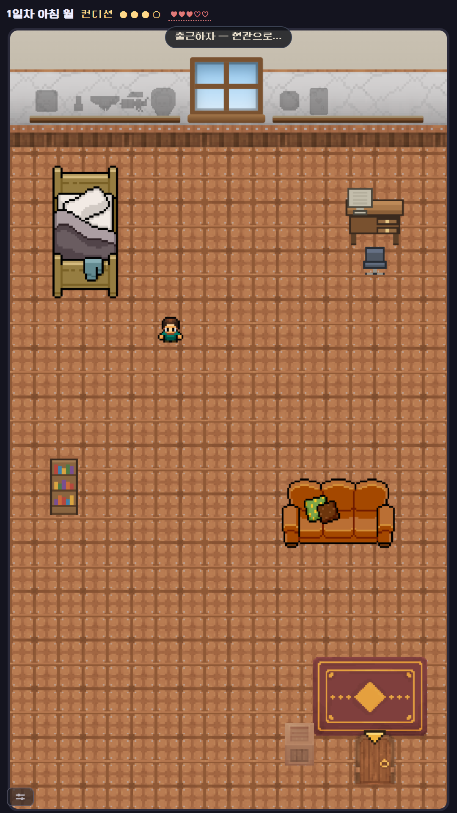
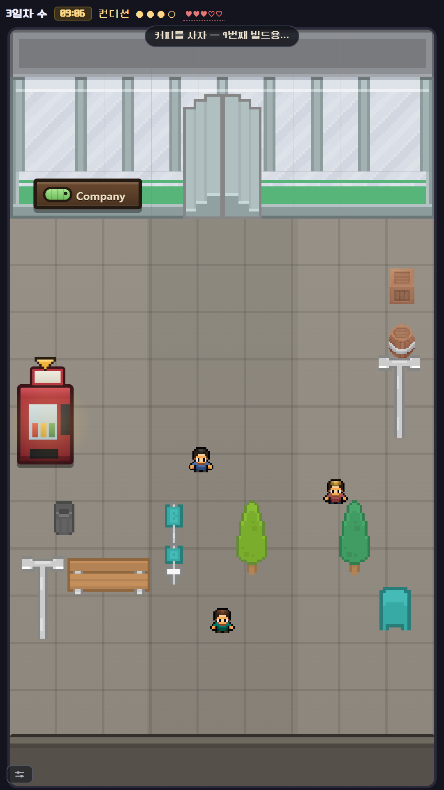
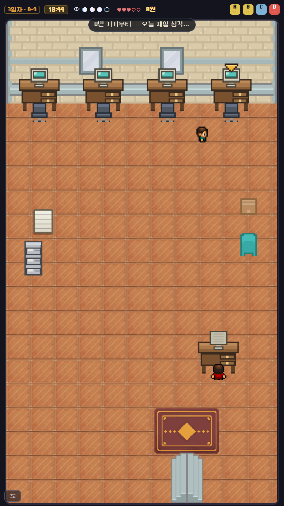
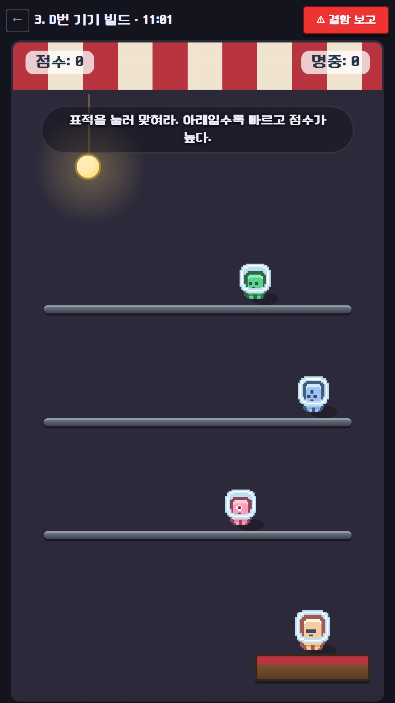
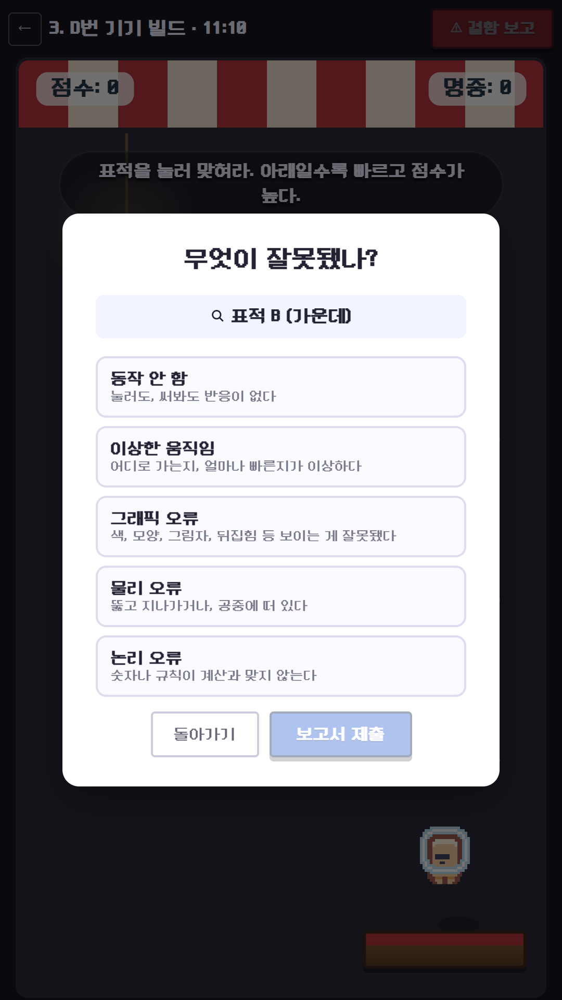
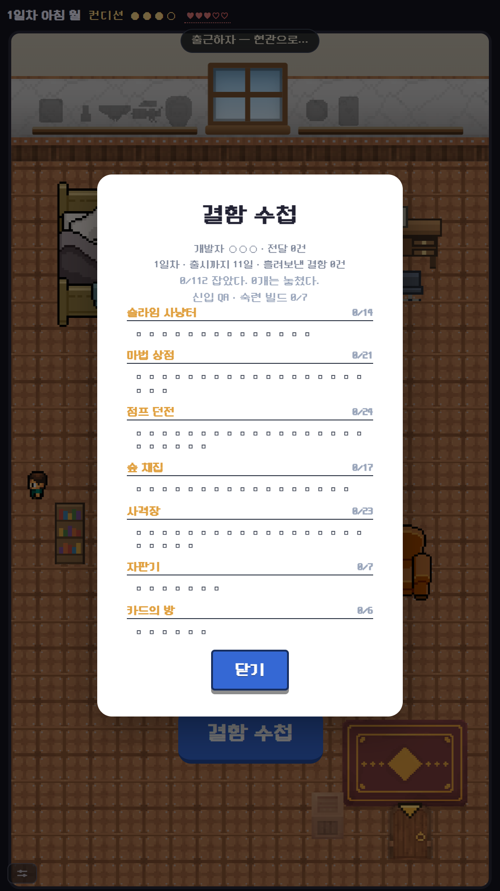

# Find the Bug

> 버그를 만드는 쪽이 아니라, 찾는 쪽이 되어라.

QA 테스터가 되어 12일짜리 스프린트를 버티는 게임입니다. 매일 아침 책상에 빌드 큐가 쌓이고,
각 빌드는 결함 하나가 심어진 작은 플레이 가능한 씬입니다. 찾아내고, 어떤 종류인지 분류하고,
승인해야 합니다. Verse8(Agent8) 플랫폼에 배포했고, 설치 없이 브라우저에서 바로 돌아갑니다.

**▶ 플레이: https://verse8.io/B9h4t9L**



## 어떤 게임인가

하루는 09:00에 시작해 18:00에 끝나고, **실제 1초당 게임 내 2.3분**이 흐릅니다. 들여다보는 것
자체가 시간을 쓰기 때문에, 이 게임에서 모자란 자원은 언제나 시간입니다.

- 스테이지 그리드가 아닙니다. 집이 있고, 출근길이 있고, 사무실이 있습니다. 빌드는 그 하루
  안의 책상에서 열립니다.
- 자원은 **시간**과 **컨디션** 둘. 컨디션은 하루에 열어볼 수 있는 빌드 수를 제한합니다.
- 돈은 있지만 의도적으로 빈약합니다. 한 런의 수입이 상점 물건값보다 적어서, 장비는
  체크리스트가 아니라 선택이 됩니다.
- **판정은 물체 + 분류 둘 다**입니다. 어느 쪽이 틀렸는지는 알려주지 않습니다.
- 보고는 **빌드당 한 번**뿐입니다.



## 하루

사무실에는 책상이 4개, 컨디션은 3점입니다. 넷 다 보려면 커피를 사거나 야근을 하거나,
아니면 하나는 보지 않은 채로 내보내야 합니다. 상단 우측 칩이 오늘의 빌드 큐이고, 점 개수가
심각도입니다.



빌드를 열면 그건 진짜로 플레이할 수 있는 게임입니다. 슬라임 사냥터, 마법 상점, 점프 던전,
숲 채집, 사격장, 자판기, 카드의 방 — 만져보지 않으면 드러나지 않는 결함이 있기 때문에
직접 해봐야 합니다.



찾았으면 대상을 지목하고 분류를 고릅니다. 둘 다 맞아야 잡은 것으로 칩니다.



런은 남지 않습니다. 남는 건 **결함 수첩** 하나 — 7개 빌드에 걸친 112개 결함 중 한 런에서
만나는 건 40개쯤입니다. 다시 하는 이유는 아직 못 만난 것들입니다.



## 구조에서 신경 쓴 것

**결함은 손으로 쓰지 않고 생성됩니다**

19개의 mutator가 씬의 오브젝트와 교차해 결함 풀을 만들고, 스코어러가 각 결과를 난이도
1–4 밴드로 등급화하고, 커리큘럼이 그 밴드에서 30개 스테이지 슬롯을 배분합니다. 결함 목록을
관리하는 파일은 없습니다 — 씬을 작성하면 풀이 거기서 떨어져 나옵니다.

```
src/engine/generate.ts     mutator × 오브젝트 = 결함 풀
src/engine/score.ts        각 결함을 밴드 1–4로 등급화
src/engine/curriculum.ts   밴드에서 30개 스테이지 슬롯 배분
src/engine/exclusions.ts   손으로 빼는 유일한 자리
```

문서화된 예외가 하나 있습니다. 카드 맞추기 빌드는 데이터 모델로 표현되지 않는 규칙이라
자기 컴포넌트와 자기 손수 쓴 풀을 씁니다.

**씬을 고치면 풀이 조용히 무너집니다**

그래서 검증 스크립트가 16개 붙어 있습니다. `npm run verify`가 커리큘럼 · 씬 · 런타임 · i18n ·
퀘스트 · 카테고리 · 레이아웃 · 마스터리 · 트로피 · 랭크까지 회귀로 확인하고, 스테이지 풀이
최소치(3) 밑으로 떨어지면 빌드를 실패시킵니다. 밸런스는 `npm run sim`의 봇으로 "숙련까지
몇 런 걸리는지"를 재서 확인합니다.

**서버 없이도 게임이 돕니다**

계정 · 저장 · 랭킹은 `@agent8/gameserver`가 맡지만, `src/net/save.ts`의 모든 호출은 조용히
실패해도 되도록 되어 있습니다. 수첩은 병합만 합니다 — 잡은 것이 못 잡은 것으로 되돌아가지
않습니다. 서버와 클라이언트 양쪽에서.

**개발 도구는 일부러 배포본에 실려 있습니다**

`VITE_DEV_TOOLS=1`이 켜져 있는 동안 화면 구석에 `DEBUG` 태그가 붙고, 주소창 파라미터로
날짜 · 장소 · 시각을 건너뛰고 결함 목록을 열 수 있습니다. 검수할 가치가 있는 빌드는 서버에
올라간 그 빌드이기 때문입니다. 실제로 나가는 빌드는 `npm run build:release`가 이걸 끕니다.
(이 README의 스크린샷도 그 파라미터로 찍었습니다.)

## 기술 스택

| 영역 | 사용 기술 |
|---|---|
| 클라이언트 | React 18(고정), TypeScript, Vite |
| 렌더링 | DOM + 손으로 쓴 CSS. Tailwind 없음 |
| 서버 | Verse8/Agent8 `server.js` — 계정 · 저장 · 랭킹 |
| 검증 | `tsx` 스크립트 16종, 시뮬레이션 봇 기반 밸런스 측정 |
| i18n | 5개 언어. 전부 채워야 `verify` 통과 |
| 아트 | CC0 스프라이트 시트, `npm run sprites`로 패킹 |
| 린트 | oxlint |

React 18은 고정입니다. `@agent8/gameserver`의 peer가 `react@^18.2.0`입니다. `vite.config.ts`의
`dedupe` / `optimizeDeps` 블록도 지우면 안 됩니다 — SDK와 앱이 서로 다른 React를 잡아
개발 서버에서 `Invalid hook call`이 납니다.

## 실행

```bash
npm install
npm run dev
```

```bash
npm run verify         # 회귀 검증 전체
npm run lint           # oxlint, 경고 0이 정상
npm run typecheck      # tsc -b
npm run sim            # 숙련까지 몇 런 걸리는지 시뮬레이션
npm run report         # docs/bug-review.{md,json,html} 재생성
npm run build:release  # 실제로 나가는 빌드
```

씬 · mutator · 점수 · 커리큘럼을 건드렸으면 `npm run report`를 같이 돌려 `docs/bug-review.*`를
커밋합니다. 안 그러면 검수 목록이 코드보다 뒤처집니다.

## 저장소 구조

```
src/engine/      결함 생성 · 스코어링 · 커리큘럼 · 씬 런타임
src/core/        판정, 런 상태
src/stages/      씬 데이터와 레지스트리
src/office/      사무실 · 책상 · 하루 · 랭크
src/street/      거리, 상점, 포장마차
src/home/        집, 결함 수첩, 트로피
src/net/         계정 · 저장 (실패해도 되는 호출들)
src/i18n/        5개 언어 사전
scripts/         검증 · 리포트 · 아트 파이프라인
PROJECT/         설계 컨텍스트, 요구사항, 불변식
docs/            결함 검수 목록, 배포, 에셋, 수익화, 스크린샷
```
